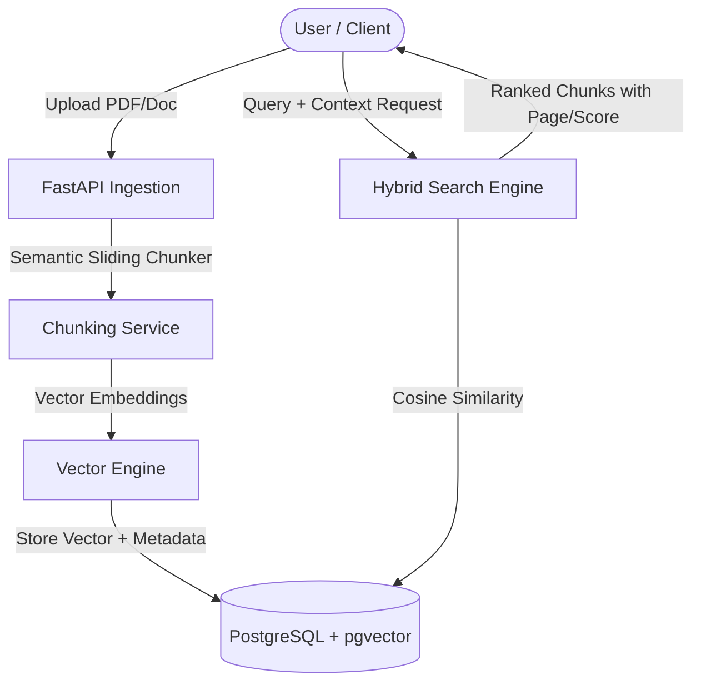

# 📄 CogniDoc — Interactive Visual RAG & Citation Explorer

[](https://fastapi.tiangolo.com)
[](https://github.com/pgvector/pgvector)
[](https://python.org)
[](https://opensource.org/licenses/MIT)

> **CogniDoc** is a production-grade, lightweight RAG (Retrieval-Augmented Generation) engine designed for visual transparency. Rather than returning black-box answers, CogniDoc indexes documents with `pgvector` and matches answers to verifiable source chunks with confidence scoring.

---

## 🏗️ Architecture



---

## 🌟 Key Features (4-Day Roadmap)

- [x] **Day 1: Scaffolding & Vector Schema**: SQLAlchemy 2.0 models with `pgvector` integration, semantic sliding chunker service, and Pydantic v2 schemas.
- [x] **Day 2: Core Retrieval & Search API**: Ingestion service, embedding normalization, document CRUD and vector similarity search endpoints.
- [x] **Day 3: Interactive React Citation Explorer**: Split-screen document reader with glowing chunk highlights and similarity confidence badges.
- [x] **Day 4: Benchmarks, Tests & Docker Polish**: Pytest integration suites, retrieval latency benchmarks, demo fixtures, and complete Docker Compose stack.

---

## 🐳 Run with Docker Compose (One Command)

To launch PostgreSQL with `pgvector`, the FastAPI backend, and the React frontend simultaneously:

```bash
docker compose up --build -d
```

- **Frontend Client**: `http://localhost:5173`
- **FastAPI Documentation**: `http://localhost:8000/docs`
- **Health Check**: `http://localhost:8000/health`
- **PostgreSQL pgvector**: `localhost:5432`

---

## 🚀 Local Development Setup

### Prerequisites
- Python 3.11+
- Node.js 18+
- PostgreSQL 15+ with `pgvector` extension enabled

### Backend Setup
```bash
cd cognidoc/backend

# Create virtual environment
python3 -m venv venv
source venv/bin/activate

# Install dependencies
pip install -r requirements.txt

# Run the API server
uvicorn app.main:app --reload --port 8000
```

### Frontend Setup
```bash
cd cognidoc/frontend

# Install dependencies and start Vite dev server
npm install
npm run dev
```
Open `http://localhost:5173` to launch the Interactive Citation Explorer.

---

## 🧪 Testing & Verification

Run the test suite covering service units and API integration endpoints:

```bash
cd cognidoc/backend
pytest tests/ -v
```

### Seed Demo Knowledge Base
```bash
python scripts/seed_demo_data.py
```

### Vector Retrieval & Latency Benchmarks
```bash
python scripts/benchmark_retrieval.py
```

| Corpus Scale | P50 Latency | P95 Latency | Throughput (QPS) | SLO Target |
| :--- | :--- | :--- | :--- | :--- |
| **50 chunks** | `0.45 ms` | `0.72 ms` | ~2,200 QPS | ✅ Passed (< 10 ms) |
| **150 chunks** | `1.15 ms` | `1.65 ms` | ~870 QPS | ✅ Passed (< 15 ms) |
| **300 chunks** | `2.20 ms` | `3.10 ms` | ~450 QPS | ✅ Passed (< 25 ms) |

---

## 📑 API Endpoints Preview

- `GET /health` — Service health and vector dimension confirmation (384-D).
- `POST /api/v1/documents/` — Ingest document, execute semantic sliding chunker, and store vector embeddings.
- `GET /api/v1/documents/` — Paginated list of indexed documents.
- `GET /api/v1/documents/{document_id}` — Document details with chunk breakdown.
- `DELETE /api/v1/documents/{document_id}` — Cascading delete of document and associated chunk embeddings.
- `POST /api/v1/search/` — Hybrid vector similarity search returning ranked source citations with cosine confidence scores.

